  

  
  
  

## About

Gen AI Engineer from **Thiruvananthapuram, Kerala**. I graduated with a B.Tech in Information Technology from Amal Jyothi College of Engineering (2022–2026). Open to **Gen AI roles and freelance work**.

- **VoiceStack (CareStack):** built an AI configuration assistant with Claude and LangGraph, OpenAPI tool integration, MCP servers, human-in-the-loop approvals, SSE streaming and Langfuse tracing.
- **CareStack:** built a voice-bot testing platform with chat-based simulation and GPT-based evaluation of bot responses.
- **Nilgiri Stores:** cloud deployment on Hetzner (Apache, HTTPS) and an SQL-grounded AI chatbot.
- **Final-year project:** PM2.5 prediction from satellite data using Random Forest (R² 0.894 on the test set).

## Stack

## Projects

| | Project | Stack |
| :-: | --- | --- |
| 01 | [PM2.5 from satellite data](https://renny-thomas.vercel.app/work/pm25-satellite-machine-learning) | Python, Scikit-learn |
| 02 | [AI configuration assistant (VoiceStack)](https://renny-thomas.vercel.app/work/ai-configuration-assistant-voicestack) | Claude, LangGraph, MCP |
| 03 | [Voice-bot testing platform (CareStack)](https://renny-thomas.vercel.app/work/voice-bot-testing-platform-carestack) | LLM evals, Langfuse |
| 04 | [AI Phone Advisor (AIPA)](https://renny-thomas.vercel.app/work/ai-phone-advisor-aipa) | RAG, FAISS |
| 05 | [AI research agent](https://renny-thomas.vercel.app/work/ai-research-agent-tavily-deepseek) | Tavily, DeepSeek |
| 06 | [Scraping pipeline](https://renny-thomas.vercel.app/work/web-scraping-pipeline-scrapy) | Scrapy |

Animated case studies for all 10 projects are on the **[portfolio](https://renny-thomas.vercel.app)**.

## Activity

  
  

